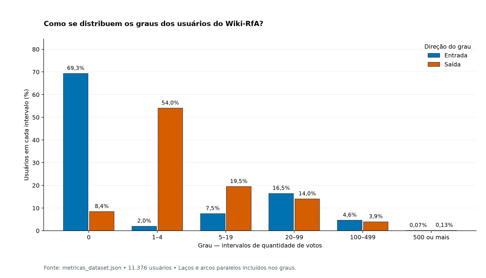
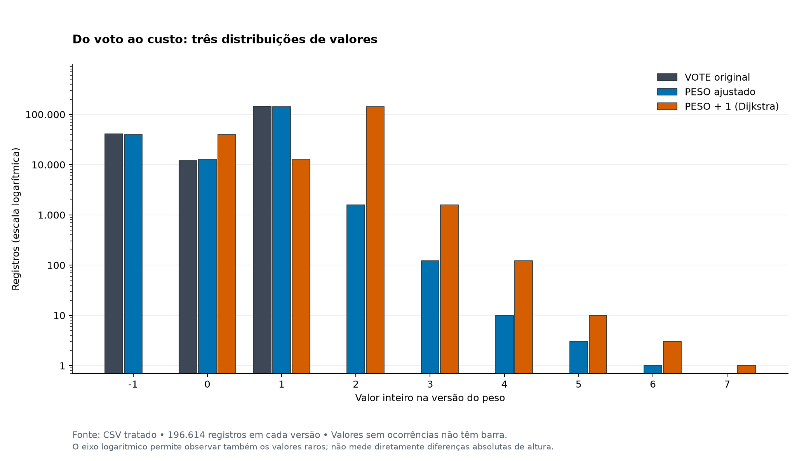
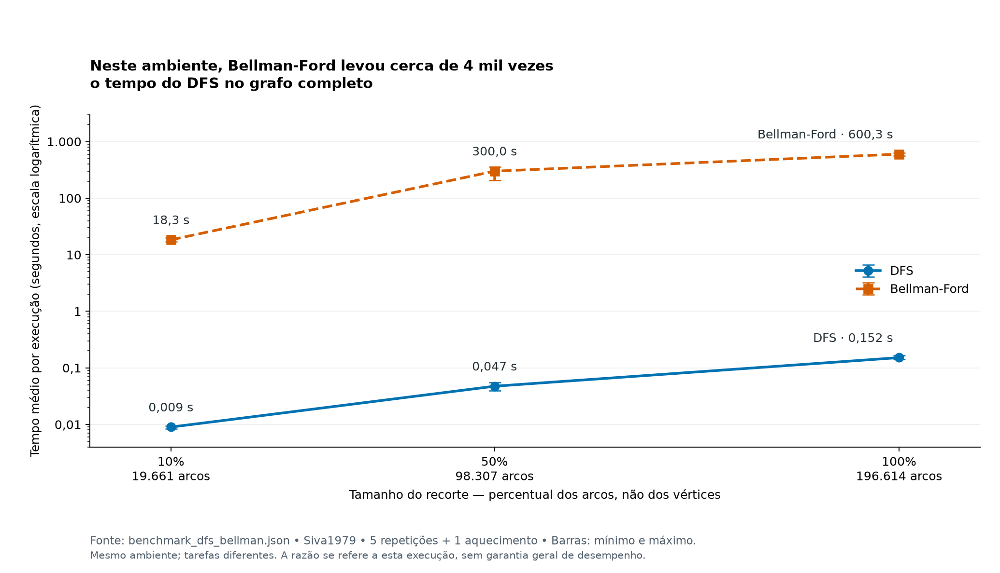
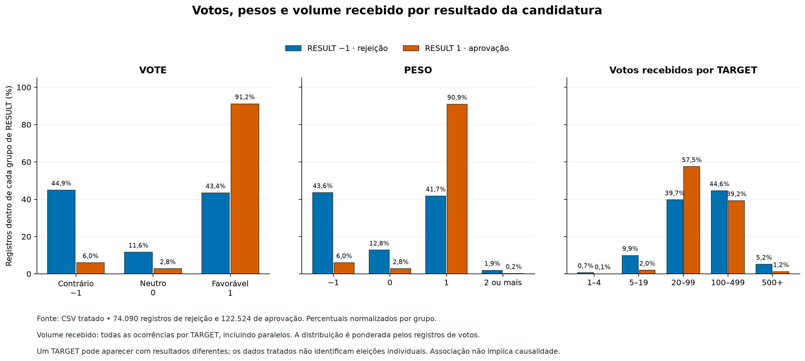
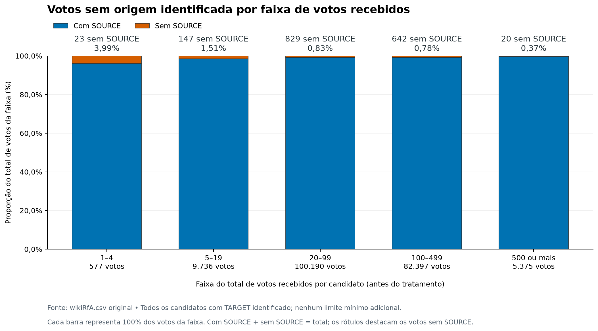
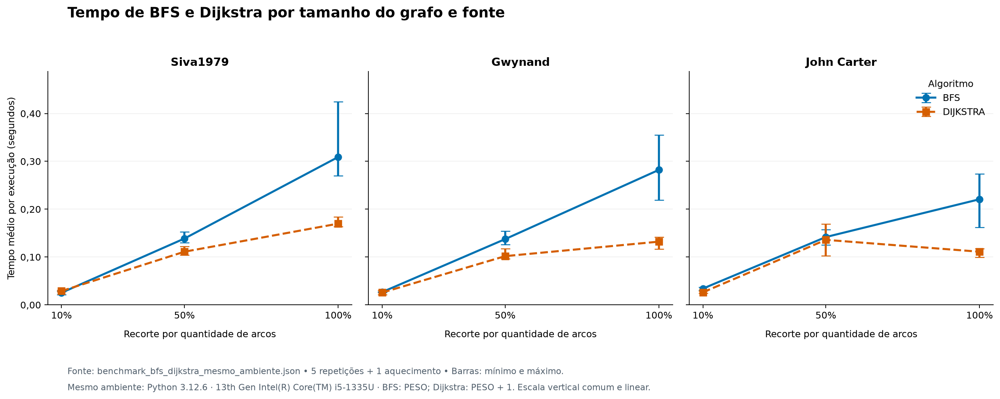
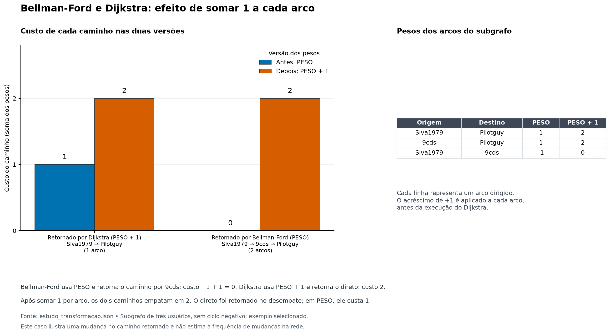

# Parte 2 — Wiki-RfA: dados, algoritmos e visualizações

Data de atualização: 24/11/2026.

Este documento reúne as implementações, os resultados salvos e as decisões registradas para a Parte 2. A organização e a redação tiveram apoio de ChatGPT (Codex). As análises e justificativas foram revisadas pelo grupo, conforme confirmação recebida. A seção 9.1 identifica apenas os campos de identificação e contribuição ainda sem preenchimento neste arquivo.

O objetivo da segunda etapa é representar uma rede real como grafo dirigido e ponderado, executar BFS, DFS, Dijkstra e Bellman-Ford e comparar seus resultados e desempenho. O relatório reúne a descrição dos dados, a modelagem, os experimentos e as sete visualizações produzidas. A seção 8 apresenta o manual de execução; a seção 9 reúne as contribuições conhecidas e os campos administrativos a preencher.

## 1. Dataset e pergunta de pesquisa

O Wiki-RfA representa votos nas candidaturas a administrador da Wikipédia. A versão reduzida utilizada foi obtida no Kaggle e tem quatro atributos originais: SOURCE, TARGET, VOTE e RESULT. 

Fonte usada: https://www.kaggle.com/datasets/boneacrabonjac/wiki-rfa

Referência da versão original: https://snap.stanford.edu/data/wiki-RfA.html

SOURCE e TARGET identificam o eleitor e o candidato. VOTE é -1, 0 ou 1, respectivamente contra, neutro ou a favor. RESULT é -1 ou 1, respectivamente rejeição ou aprovação. PESO é uma coluna derivada do tratamento. O grafo é dirigido: cada registro tratado liga eleitor a candidato. Os pesos negativos se originam dos votos contrários.

| Atributo | Tipo e valores | Papel na análise |
|---|---|---|
| `SOURCE` | Identificador textual de usuário | Origem do arco; eleitor que emitiu o voto |
| `TARGET` | Identificador textual de usuário | Destino do arco; candidato que recebeu o voto |
| `VOTE` | Categórico ordinal: -1, 0 ou 1 | Posicionamento contrário, neutro ou favorável |
| `RESULT` | Categórico: -1 ou 1 | Resultado de rejeição ou aprovação da candidatura |
| `PESO` | Inteiro derivado; de -1 a 6 nesta base | Peso usado no grafo tratado, antes do deslocamento de Dijkstra |

Os 196.614 arcos do grafo tratado superam o mínimo de 20.000 exigido para a Parte 2. O dataset completo tratado é utilizado nos casos gerais; os recortes de 10% e 50% servem à avaliação de escalabilidade.

Pergunta de pesquisa aprovada: Como a transformação dos pesos negativos para permitir o uso de Dijkstra altera os caminhos mínimos e a interpretação dos custos no grafo Wiki-RfA?

### 1.1. Significado dos caminhos e dos ciclos negativos

Um caminho dirigido encadeia registros de votos: cada usuário votou no usuário seguinte. No BFS, o mínimo corresponde à menor quantidade de arcos dessa cadeia. Nos algoritmos ponderados, o custo é a soma dos pesos dos arcos; trata-se de um critério matemático definido para o experimento, sem equivalência automática com confiança, influência ou probabilidade de aprovação.

Um ciclo negativo é uma sequência fechada de votos cuja soma dos pesos é menor que zero. Quando alcançável a partir da origem, sua repetição permite reduzir indefinidamente o custo dos percursos que o atravessam. Por isso, para destinos alcançáveis a partir desse ciclo, não há custo mínimo finito. Na rede estudada, o ciclo de votos contrários entre Rcsprinter123 e Jasper Deng fornece um exemplo real dessa situação. A soma negativa não representa, por si só, uma medida de conflito social ou uma conclusão sobre os usuários.

## 2. Qualidade dos dados e tratamentos

O CSV bruto contém 198.275 registros. Há 1.661 sem SOURCE, distribuídos entre 926 candidatos. Não foram encontrados valores ausentes em TARGET, VOTE ou RESULT. A causa da ausência não foi determinada; não foi assumida ausência aleatória. Os registros sem origem identificada foram excluídos apenas da construção do grafo, pois atribuir um eleitor exigiria inventar informação. Permanecem preservados no CSV bruto. O grafo tratado representa 196.614 registros com eleitor identificado; a exclusão pode afetar graus e conectividade.

Laços e arcos paralelos foram mantidos. Não há data nem identificador de eleição nesta versão, de modo que linhas iguais não comprovam duplicação indevida. Repetições exatas são definidas simultaneamente por SOURCE, TARGET, VOTE e RESULT. Dentro de cada grupo, na ordem original, PESO = VOTE + número da ocorrência, começando em zero. VOTE é preservado. A regra foi informada e confirmada por André, com atribuição da sugestão à professora Laura, conforme o log.

Outliers foram conferidos em verificacao_outliers.json, sem novas exclusões. Com limites de 1,5 IQR nos graus, incluindo zeros, foram sinalizados 2.150 usuários na entrada e 1.718 na saída. Os cinco maiores de cada direção foram conferidos contra os registros brutos mantidos. As 14 ocorrências com PESO >= 4 foram rastreadas; o máximo é 6 e os valores conferem com a regra de incremento. Ser sinalizado por uma regra estatística não foi tratado como prova de erro.

A exploração de RESULT compara VOTE, PESO agrupado e volume recebido por TARGET entre grupos de resultado. São 74.090 registros no grupo -1 e 122.524 no grupo 1. Existem 236 TARGETs com resultados diferentes; sem identificador de eleição, não se deve reduzir cada candidato a um único resultado. As proporções são ponderadas pelos registros de votos, não por candidatos ou eleições.

### 2.1. Organização pelos quatro pilares de AVD

| Pilar | Procedimento realizado | Evidência no projeto |
|---|---|---|
| Estrutural | Identificação das colunas e seus tipos, contagem dos registros, inspeção de faltantes, laços e repetições | Notebook de preparação; métricas da seção 3; figura B01 |
| Distribucional | Frequências de votos e pesos e distribuição dos graus de entrada e saída | Figuras A01 e A02; `metricas_dataset.json` |
| Relacional | Comparação de VOTE, PESO e volume de votos recebidos entre grupos de RESULT | Figura A04; `dados_visualizacoes_andre.json` |
| Outliers | Sinalização por 1,5 IQR nos graus e rastreamento dos pesos elevados no CSV bruto | `verificacao_outliers.json`; conferências descritas nesta seção |

Não foi possível classificar o mecanismo de ausência de SOURCE como MCAR, MAR ou MNAR com os atributos disponíveis. A decisão de excluir esses registros apenas do grafo decorre da impossibilidade de identificar a origem do arco. Os valores extremos conferidos foram mantidos, pois os registros sustentam sua ocorrência e não foi identificado erro que justificasse removê-los.

### 2.2. Rastreabilidade e limites do tratamento

A sequência de preparação é: preservar o CSV bruto; identificar os registros sem SOURCE; selecionar as linhas com origem identificada; calcular a ordem de ocorrência dos grupos iguais em SOURCE, TARGET, VOTE e RESULT; criar PESO; exportar o CSV tratado. Por exemplo, três ocorrências de um voto contrário no mesmo grupo recebem PESO -1, 0 e 1, enquanto VOTE permanece -1 nas três. Assim, PESO é um custo derivado e não deve ser interpretado como o voto original.

O critério de outliers usa os quartis dos graus de todos os vértices, incluindo zeros. Na entrada, Q1 = 0 e Q3 = 11, com limite superior de 27,5; na saída, Q1 = 1 e Q3 = 11, com limite superior de 26. O exame individual cobriu os cinco maiores graus de cada direção, não todos os usuários sinalizados. Nos pesos, foram rastreados os 14 registros com PESO >= 4. A conferência da regra de incremento, por sua vez, abrangeu todas as linhas tratadas.

O carregador recebe o CSV já tratado: valida a presença das colunas necessárias, exige SOURCE e TARGET preenchidos e converte PESO para inteiro. Não aplica novamente o incremento e não remove paralelos. A separação entre preparação e carregamento evita modificar os pesos a cada execução dos algoritmos.

## 3. Representação e métricas

O grafo é um dicionário de listas de pares (destino, peso). Origens e destinos são criados como chaves, incluindo candidatos que apenas recebem votos. Todas as ocorrências são preservadas, inclusive laços e paralelos.

Essa estrutura representa um multigrafo dirigido e ponderado. A direção eleitor → candidato é preservada: receber um voto não implica ter votado no eleitor. A lista de adjacência mantém a ordem dos registros do CSV tratado, utilizada na exploração e na classificação de arcos pela DFS.

| Métrica | Valor |
|---|---:|
| Vértices | 11.376 |
| Arcos, com laços e paralelos | 196.614 |
| Laços, por ocorrência | 103 |
| Pares dirigidos distintos, com laços | 188.077 |
| Pares distintos sem laço | 187.984 |
| Densidade dos pares sem laço | 0,00145271325 |
| Grau de entrada: mínimo / máximo / média | 0 / 978 / 17,2832 |
| Grau de saída: mínimo / máximo / média | 0 / 1.232 / 17,2832 |
| Votos originais negativos | 20,68% |
| Pesos ajustados negativos | 20,169% |

Cada arco paralelo contribui separadamente para os graus. Um laço soma um na entrada e um na saída. A soma dos graus de entrada e a soma dos de saída são iguais ao número de arcos. A densidade usa pares distintos sem laço divididos por V(V-1), para medir ocupação dos pares possíveis sem confundir multiplicidade com densidade de grafo simples. Distribuições e graus por usuário estão em metricas_dataset.json.

### 3.1. Organização da implementação

| Arquivo | Responsabilidade na Parte 2 |
|---|---|
| `src/graphs/io.py` | Carregar e validar o CSV tratado, preservando direção, nomes e ocorrências |
| `src/graphs/graph.py` | Operações da lista de adjacência dirigida |
| `src/graphs/algorithms.py` | Implementações próprias dos quatro algoritmos |
| `src/graphs/metricas_dataset.py` | Graus, distribuições, densidade e contagens do grafo |
| `src/solve.py` e `src/cli.py` | Orquestrar chamadas, preparar os casos e exportar resultados |
| `src/benchmark.py` | Recortes, seleção de fontes, medição e benchmark de BFS/Dijkstra |
| `src/benchmark_dfs_bellman.py` | Benchmark de DFS/Bellman-Ford |
| `src/viz.py` | Gerar as figuras a partir dos dados e resultados salvos |
| `src/verificar_parte2.py` | Conferências técnicas de DFS, RESULT e outliers |

Os algoritmos não são delegados a bibliotecas de grafos. As estruturas auxiliares incluem `deque` no BFS, pilha explícita na DFS e `heapq` no Dijkstra. O uso de `networkx` fica restrito aos testes como referência de corretude.

## 4. Algoritmos e casos obrigatórios

### 4.1. BFS e DFS em três fontes

BFS foi executado em Siva1979, 'sed e !---slappdash---!. Calcula o menor número de arcos e ignora os pesos. Para Siva1979, alcançou 3.443 outros usuários e a maior distância finita foi de cinco arcos. Inalcançáveis são exportados como null. Brenda conferiu manualmente o recorte Siva1979 → Ceranthor → Salvio giuliano → 07bargem, com distâncias 0, 1, 2 e 3; o último arco tem PESO -1 e continua contando como um passo.

DFS foi executado nas mesmas três fontes. Registra descoberta, término, predecessores, classificação de arcos e ciclos dirigidos, preservando ocorrências paralelas. Seu indicador de ciclo não informa se um ciclo tem peso negativo. A conferência técnica exportada é automática; o arquivo conferencia_tecnica_dfs.json não deve ser apresentado como conferência manual de André.

| Fonte | Outros usuários alcançados por BFS | Maior distância BFS, em arcos | Vértices visitados por DFS, incluindo a fonte | Arcos classificados por DFS | Ciclo dirigido detectado |
|---|---:|---:|---:|---:|---|
| `Siva1979` | 3.443 | 5 | 3.444 | 125.455 | Sim |
| `'sed` | 3.444 | 6 | 3.445 | 125.458 | Sim |
| `!---slappdash---!` | 3.444 | 7 | 3.445 | 125.456 | Sim |

Fonte: [bfs_fontes.json](../out/parte2/bfs_fontes.json) e [dfs_fontes.json](../out/parte2/dfs_fontes.json). As camadas de BFS são os conjuntos de usuários com a mesma distância finita, tomando a origem como camada zero. Os JSONs preservam as distâncias e os predecessores de BFS e a ordem de descoberta, os tempos e as classes de arcos de DFS. A busca DFS desses casos cobre somente a região alcançável a partir de cada origem.

As contagens por camada, calculadas a partir das distâncias salvas de BFS, são:

| Camada | Siva1979 | 'sed | !---slappdash---! |
|---|---:|---:|---:|
| 0 | 1 | 1 | 1 |
| 1 | 1.101 | 3 | 1 |
| 2 | 1.910 | 258 | 26 |
| 3 | 401 | 2.144 | 444 |
| 4 | 28 | 886 | 1.773 |
| 5 | 3 | 142 | 1.123 |
| 6 | 0 | 11 | 68 |
| 7 | 0 | 0 | 9 |
| Total alcançado, incluindo a fonte | 3.444 | 3.445 | 3.445 |

A exploração BFS visita as camadas em ordem crescente de distância. Dentro de cada camada, os empates dependem da ordem das listas de adjacência, preservada do CSV. A exportação contém as distâncias e predecessores, sem um campo separado com a sequência de retirada da fila. A DFS exporta explicitamente a ordem de descoberta. Seus cinco primeiros usuários em cada caso são:

| Fonte | Início da ordem de descoberta DFS |
|---|---|
| Siva1979 | Siva1979 → Blurpeace → Ktr101 → Darkwind → Jason Quinn |
| 'sed | 'sed → Yanksox → Tide rolls → 5 albert square → INeverCry |
| !---slappdash---! | !---slappdash---! → Tedder → 5 albert square → INeverCry → BDD |

As classificações de DFS registradas por fonte são:

| Fonte | Árvore | Retorno | Avanço | Cruzamento |
|---|---:|---:|---:|---:|
| Siva1979 | 3.443 | 62.161 | 46.027 | 13.824 |
| 'sed | 3.444 | 62.773 | 45.396 | 13.845 |
| !---slappdash---! | 3.444 | 62.331 | 45.748 | 13.933 |

Arcos de árvore descobrem novos vértices; de retorno apontam para vértices ainda ativos; de avanço chegam a descendentes já finalizados; de cruzamento ligam outros vértices já finalizados. A existência de arcos de retorno indica ciclos dirigidos na região explorada. As somas das quatro classes coincidem com os totais de arcos classificados da tabela anterior.

### 4.2. Dijkstra em cinco pares

Dijkstra foi executado para cinco pares distintos, com uma busca completa por origem. Como o menor PESO é -1, o grafo separado com PESO + 1 não contém pesos negativos. O algoritmo original recusa pesos negativos. O custo exportado nos cinco pares é o custo transformado. Os caminhos não podem ser apresentados como mínimos da versão anterior por simples equivalência de custos.

| Origem | Destino | Arcos do caminho retornado | Custo em PESO + 1 | Status |
|---|---|---:|---:|---|
| `Siva1979` | `(aeropagitica)` | 3 | 0 | OK |
| `Siva1979` | `Dieter Simon` | 5 | 6 | OK |
| `'sed` | `9cds` | 2 | 2 | OK |
| `'sed` | `Caltrop` | 7 | 8 | OK |
| `!---slappdash---!` | `Caltrop` | 8 | 8 | OK |

Fonte: [dijkstra_pares.json](../out/parte2/dijkstra_pares.json), que também contém as sequências completas dos caminhos. Foram feitas três buscas, uma por origem, aproveitando os resultados para os destinos correspondentes. Um caminho pode ter custo transformado zero porque arcos com PESO -1 passam a ter peso zero.

### 4.3. Bellman-Ford com e sem ciclo negativo

Bellman-Ford foi executado em dois subgrafos induzidos reais. Malleus Fatuorum → BDD tem peso -1 e não possui ciclo. Rcsprinter123 → Jasper Deng → Rcsprinter123 tem dois arcos de peso -1 e custo de ciclo -2. O ciclo é exibido com a sequência e as ocorrências de arcos. Distâncias provisórias do caso com ciclo negativo não são apresentadas como mínimos finitos.

| Caso | Vértices / arcos | Resultado |
|---|---|---|
| Peso negativo sem ciclo | 2 / 1 | Distância de Malleus Fatuorum a BDD igual a -1; status OK |
| Ciclo negativo | 2 / 2 | Jasper Deng → Rcsprinter123 → Jasper Deng; custo -2; status CICLO_NEGATIVO |

Fonte: [bellman_ford_casos.json](../out/parte2/bellman_ford_casos.json). Os recortes mantêm todas as ocorrências internas aos usuários escolhidos, com referências às linhas do CSV e aos índices de adjacência.

Os quatro arquivos de casos, com seus metadados, foram incluídos em casos_obrigatorios no parte2_report.json. Nenhum dos exemplos pequenos é apresentado como amostra representativa da rede inteira.

## 5. Benchmark, escalabilidade e comparação técnica

Os recortes são prefixos de 10%, 50% e 100% das ocorrências embaralhadas uma vez com semente 42. São aninhados e preservam os pesos já calculados. Os vértices efetivos são a união das origens e destinos selecionados. Há 19.661, 98.307 e 196.614 arcos e 5.636, 9.187 e 11.376 vértices, respectivamente.

| Recorte por ocorrências de arcos | Vértices efetivos | Arcos |
|---|---:|---:|
| 10% | 5.636 | 19.661 |
| 50% | 9.187 | 98.307 |
| 100% | 11.376 | 196.614 |

Os percentuais referem-se aos arcos, não aos vértices. O recorte de 10% tem menos de 20.000 arcos porque é uma configuração de escalabilidade; a exigência de tamanho do dataset é atendida pelo grafo completo. O procedimento não é apresentado como amostragem representativa de comunidades ou de eleições.

As fontes do benchmark são Siva1979, Gwynand e John Carter, escolhidas deterministicamente no menor recorte por grau de saída >= 3, ordem por grau decrescente e nome crescente, nas posições 0, n // 4 e n // 2. São mantidas nos três tamanhos.

Apenas a chamada do algoritmo é cronometrada com perf_counter. Há um aquecimento fora do cronômetro e cinco repetições por configuração. Preparação, exportação e conferência de alcance ficam fora. O tempo inclui a preparação interna de cada implementação. São preservados média, mínimo, mediana, desvio padrão amostral e os cinco tempos individuais. Barras das figuras representam mínimo e máximo, não intervalos de confiança.

A consolidação atual usa benchmark_bfs_dijkstra_mesmo_ambiente.json e benchmark_dfs_bellman.json. Ambos registram Python 3.12.6, Windows 10.0.26300 como versão do sistema, Intel Core i5-1335U e 16.847.937.536 bytes de memória. O hash do CSV coincide nas contribuições e com o arquivo atual. Metadados iguais não comprovam carga idêntica da máquina durante sessões distintas.

BFS, DFS e Dijkstra têm três fontes em cada tamanho. Bellman-Ford tem três fontes em 10% e 50% e Siva1979 em 100%. Isso totaliza 34 configurações e 170 tempos. O critério escrito exige os quatro algoritmos em três tamanhos e três fontes especificamente para BFS/DFS; não exige explicitamente três fontes de Bellman-Ford por tamanho. A redução em 100% limita a comparação entre fontes e é preservada no relatório. As duas fontes adicionais completariam o plano ampliado, mas não são tratadas aqui como requisito escrito ausente.

Para a fonte comum Siva1979, as médias registradas em segundos são:

| Algoritmo | 10% | 50% | 100% |
|---|---:|---:|---:|
| BFS | 0,025365 | 0,138694 | 0,309036 |
| DFS | 0,008978 | 0,047360 | 0,151690 |
| Dijkstra | 0,028914 | 0,111150 | 0,169753 |
| Bellman-Ford | 18,344376 | 300,042496 | 600,291621 |

Comparação técnica: BFS é adequado para alcance e mínimo de arcos; DFS para estrutura e ciclos dirigidos; Dijkstra para mínimos com pesos não negativos; Bellman-Ford para mínimos com pesos negativos e detecção de ciclos negativos alcançáveis. Não respondem à mesma pergunta, portanto menor tempo não torna um deles substituto geral dos demais.

BFS e DFS têm custo O(V+E) nesta representação, incluindo a preparação do BFS. Dijkstra usa heap com entradas repetidas e descarte das antigas; um limite conservador para o multigrafo é O(V + E log E). Bellman-Ford realiza todas as V-1 passagens e tem custo O(VE); não foi introduzida parada antecipada. Os resultados são compatíveis com tarefas e custos diferentes, mas três tamanhos e cinco repetições não demonstram uma lei assintótica nem isolam causas de cada diferença de tempo.

O BFS usa deque e dicionários, sem fila por pop(0) ou busca de visitados em lista. Percorre todos os arcos também na preparação; Dijkstra percorre os arcos na validação dos pesos. Não foi identificado erro que justificasse alterar os algoritmos apenas para mudar sua posição no gráfico. Os conjuntos alcançados por BFS e Dijkstra foram comparados independentemente e coincidem nas nove combinações de fonte e tamanho.

### 5.1. Crescimento observado e adequação dos algoritmos

Para Siva1979, entre 10% e 100%, a quantidade de arcos cresce cerca de dez vezes e a de vértices, cerca de duas vezes. As médias de BFS, DFS, Dijkstra e Bellman-Ford crescem aproximadamente 12,18, 16,90, 5,87 e 32,72 vezes, respectivamente. Esses fatores descrevem as medições salvas; não são estimativas da complexidade assintótica. O tamanho da região alcançável, os pesos, a ordem dos arcos, as estruturas de dados e a carga da máquina também influenciam os tempos.

| Algoritmo | Tarefa e pesos | Custo de tempo da implementação | Uso adequado e limite |
|---|---|---|---|
| BFS | Alcance e menor quantidade de arcos; ignora PESO | O(V + E) | Camadas e distância em passos; não minimiza a soma de custos |
| DFS | Ordem de exploração, classes de arcos e ciclos; ignora PESO | O(V + E), como limite para a busca | Estrutura da região alcançável; não calcula caminhos mínimos |
| Dijkstra | Menor soma em PESO + 1, com heap | O(V + E log E), limite conservador para o multigrafo | Pesos não negativos; a transformação muda o problema de custo |
| Bellman-Ford | Relaxamento em PESO e detecção de ciclo negativo alcançável | O(VE), sem parada antecipada | Admite negativos; ciclos negativos impedem mínimos finitos nos destinos afetados |

O tempo do benchmark corresponde à chamada completa de cada implementação. Para Bellman-Ford, isso inclui a verificação e eventual reconstrução de ciclo negativo; medir sua execução não significa que tenham sido obtidas distâncias mínimas finitas para toda a rede. O estudo não mede consumo de memória e não estabelece controle de carga entre sessões.

## 6. Transformação e resposta à pergunta de pesquisa

Para um caminho com k arcos, somar 1 a cada arco acrescenta k ao custo total: `custo_transformado(caminho) = custo_em_PESO(caminho) + k`. Caminhos com comprimentos diferentes recebem acréscimos diferentes. O incremento por repetição que produz PESO e o deslocamento para Dijkstra são decisões distintas: o primeiro calcula PESO a partir de VOTE conforme a regra do grupo, preservando a coluna VOTE; o segundo altera os pesos de uma cópia do grafo para permitir executar Dijkstra.

Texto aprovado por Brenda: No exemplo analisado, somar 1 a cada arco altera a preferência entre os caminhos: o caminho via 9cds, inicialmente mais barato, passa a empatar com o direto. O Dijkstra retorna um caminho ótimo nos pesos transformados, mas esse caminho tem custo maior em PESO do que o encontrado por Bellman-Ford. Portanto, a transformação permite executar Dijkstra, porém não garante preservar os caminhos mínimos anteriores. Como analisamos um único par em um subgrafo, não podemos afirmar com que frequência isso acontece na rede inteira.

O estudo preserva os três arcos reais entre Siva1979, 9cds e Pilotguy. O direto tem um arco e passa de custo 1 para 2. Via 9cds são dois arcos, de pesos -1 e 1, passando de custo 0 para 2. O caminho direto foi retornado em situação de empate; ambos são mínimos nos pesos transformados. Não houve inversão estrita em favor do direto. Percursos na rede de votos são uma modelagem matemática e não comprovam, por si sós, relações causais entre usuários ou equivalência entre soma dos pesos e resultado eleitoral.

| Caminho no subgrafo | Quantidade de arcos | Custo em PESO | Custo em PESO + 1 |
|---|---:|---:|---:|
| Siva1979 → Pilotguy | 1 | 1 | 2 |
| Siva1979 → 9cds → Pilotguy | 2 | 0 | 2 |

Fonte: [estudo_transformacao.json](../out/parte2/estudo_transformacao.json). O caso isola o efeito do deslocamento sobre dois caminhos reais, sem extrapolar sua frequência para o dataset completo.

## 7. Visualizações

O azul `#0072B2` e o laranja-avermelhado `#D55E00` foram escolhidos pensando na acessibilidade para pessoas com daltonismo, com o objetivo de facilitar a distinção das séries. As barras mantêm preenchimento sólido, sem textura, e a identificação é complementada por posição, legendas, rótulos e, nos gráficos de linhas, marcadores e traçados diferentes.

O conjunto contém sete imagens: quatro exploratórias de dados (A01, A02, A04 e B01), duas explanatórias (A03 e B03) e uma análise visual de desempenho (B02). B02 não é usada para cumprir a contagem das exploratórias de dados. As escolhas e os textos completos estão nos documentos de [Brenda](visualizacoes_brenda_parte2.md) e [André](visualizacoes_andre_parte2.md).

O cinza escuro `#3E4756` é usado como referência para VOTE em A02 e no cabeçalho da tabela de B03, sobre fundo branco. Em A03 e B02, círculos e linha contínua identificam a série azul, enquanto quadrados e linha tracejada identificam a série laranja-avermelhada. Nas barras, a posição fixa das séries, as legendas e os rótulos disponíveis apoiam a leitura. A intenção de acessibilidade não equivale a uma validação específica para daltonismo ou contraste, ainda sem registro no projeto. As fontes e unidades são indicadas nas imagens; escalas logarítmicas e barras de mínimo-máximo devem ser lidas conforme as notas de cada figura.

| Figura | Tipo registrado | O que apresenta |
|---|---|---|
| A01 | Exploratória | Distribuição dos graus de entrada e saída |
| A02 | Exploratória | Distribuições de VOTE, PESO e PESO + 1 |
| A04 | Exploratória | VOTE, PESO e volume recebido por grupo de RESULT |
| B01 | Exploratória | Composição com e sem SOURCE por faixa de votos recebidos |
| A03 | Explanatória | Diferença observada entre os tempos de DFS e Bellman-Ford |
| B03 | Explanatória | Efeito do deslocamento dos pesos sobre dois caminhos reais; responde à pergunta de pesquisa |
| B02 | Análise visual de desempenho | Tempos de BFS e Dijkstra por fonte e tamanho |

### A01 — Distribuição dos graus



Fonte: metricas_dataset.json. Nota registrada no documento de André: dos 11.376 usuários, 7.885 (69,3%) têm grau de entrada zero e 961 (8,4%) têm grau de saída zero. A faixa de um a quatro votos emitidos reúne 6.144 usuários (54,0%). Barras agrupadas distinguem os dois papéis em faixas comuns. Os graus são do grafo tratado; a agregação não determina a causa dos extremos nem os transforma em erros.

**Escolha e leitura.** As faixas são 0, 1–4, 5–19, 20–99, 100–499 e 500 ou mais. Azul identifica entrada e laranja-avermelhado, saída. A posição lado a lado e os percentuais escritos permitem comparar os papéis em cada faixa. O eixo horizontal é categórico: como os intervalos têm larguras diferentes, as barras não devem ser lidas como um histograma de intervalos iguais. Graus elevados indicam concentração de registros, sem demonstrar influência causal ou erro de dados.

### A02 — Distribuição dos votos e pesos



Fonte: CSV tratado, 196.614 registros em cada versão. O documento de André registra 2.834 linhas cujo PESO difere de VOTE e redução de 40.667 para 39.655 registros negativos. A escala logarítmica permite apresentar frequências muito diferentes; altura não representa diferença absoluta linear. Eliminar negativos não comprova preservação de caminhos. Esse achado motivou a investigação do estudo B03, conforme confirmação de Brenda.

**Escolha e leitura.** Barras agrupadas por valor inteiro mostram as três versões na ordem VOTE, PESO e PESO + 1, em cinza, azul e laranja-avermelhado. O eixo vertical é logarítmico para incluir também ocorrências raras. Valores com frequência zero não recebem barra. PESO varia de -1 a 6; após o deslocamento, varia de 0 a 7.

### A03 — Tempos de DFS e Bellman-Ford



Fonte: benchmark_dfs_bellman.json; Siva1979 nos três tamanhos. O documento de André registra razão de aproximadamente 3.957 entre as médias de Bellman-Ford e DFS em 100%, específica deste ambiente e destas tarefas. A exploração da tabela de tempos motivou a mensagem e o título quantitativo. A escala logarítmica acomoda as ordens de grandeza; barras indicam mínimo e máximo. DFS e Bellman-Ford não são substitutos equivalentes.

**Da exploração à explicação.** O relato registrado parte da diferença de ordens de grandeza encontrada na tabela de tempos e procura comunicá-la mantendo fonte e tamanhos comuns. O título quantitativo, as anotações das médias e a posição das linhas destacam a mensagem. Círculos e linha contínua representam DFS; quadrados e linha tracejada representam Bellman-Ford. A relevância está em tornar visível o custo das tarefas diferentes, sem apresentar a razão como vantagem universal.

### A04 — Relações com RESULT



Fonte: CSV tratado e dados_visualizacoes_andre.json. Os painéis relacionam VOTE, PESO e volume recebido com RESULT. No grupo de rejeição, 32.184 de 74.090 votos são favoráveis (43,44%); no de aprovação, 111.695 de 122.524 (91,16%). Os percentuais são normalizados por grupo e não representam proporção de candidatos aprovados. A mesma pessoa pode aparecer em registros com resultados diferentes.

**Escolha e leitura.** Três painéis de barras agrupadas comparam rejeição, em azul, e aprovação, em laranja-avermelhado, usando percentuais dentro de cada grupo de RESULT. PESO é agrupado em -1, 0, 1 e 2 ou mais. O volume recebido é o total de registros por TARGET no CSV tratado, separado nas faixas 1–4, 5–19, 20–99, 100–499 e 500 ou mais. Cada registro de voto recebe a faixa de seu TARGET; não se calcula a proporção de candidatos em cada faixa.

Valores descritivos dos três painéis:

| Medida dentro do grupo de RESULT | Rejeição (-1) | Aprovação (1) |
|---|---:|---:|
| VOTE favorável | 43,44% | 91,16% |
| PESO igual a -1 | 43,58% | 6,01% |
| PESO igual a 1 | 41,73% | 90,93% |
| PESO de 2 ou mais | 1,94% | 0,24% |
| Registros de TARGETs com 20–99 votos recebidos | 39,67% | 57,49% |
| Registros de TARGETs com 100–499 votos recebidos | 44,58% | 39,22% |

Essas proporções são descritivas. A04 não estima causalidade, correlação linear ou intensidade de associação por uma medida estatística.

### B01 — Votos sem origem por faixa



Fonte: CSV bruto. Nota analítica: A primeira faixa apresenta o maior percentual de votos sem origem identificada, mas reúne apenas 577 votos, dos quais 23 estão sem SOURCE. Por isso, o percentual deve ser lido junto às quantidades absolutas: o maior segmento proporcional de votos sem SOURCE não representa a maior quantidade desses registros.

Na apresentação atual, cada barra representa 100% dos votos da faixa: azul para registros com SOURCE na base e laranja-avermelhado para registros sem SOURCE no topo. O empilhamento compara a composição de cada faixa; as contagens e os percentuais de faltantes escritos acima das barras permitem ler também os segmentos pequenos. A nota foi adaptada à apresentação atual, sem tratar as barras completas como tendo alturas diferentes.

Brenda aprovou as faixas 1-4, 5-19, 20-99, 100-499 e 500 ou mais como escolha de apresentação para cinco grupos legíveis, mantendo poucos votos. Os cortes não são limites estatísticos. A medida é a proporção agregada por faixa, não a média de percentuais individuais. As quantidades sem SOURCE são 23, 147, 829, 642 e 20, totalizando 1.661.

| Votos recebidos por TARGET no bruto | Candidatos | Votos | Sem SOURCE | Percentual sem SOURCE |
|---|---:|---:|---:|---:|
| 1–4 | 219 | 577 | 23 | 3,99% |
| 5–19 | 862 | 9.736 | 147 | 1,51% |
| 20–99 | 1.877 | 100.190 | 829 | 0,83% |
| 100–499 | 531 | 82.397 | 642 | 0,78% |
| 500 ou mais | 8 | 5.375 | 20 | 0,37% |

As faixas de B01 usam o CSV bruto; as de A04 usam o tratado. A remoção dos registros sem SOURCE pode alterar o total recebido por um TARGET e sua faixa. Por isso, as contagens das duas figuras não são diretamente intercambiáveis.

### B02 — Análise visual de desempenho



Fonte atual: benchmark_bfs_dijkstra_mesmo_ambiente.json. Brenda escolheu três painéis para comparar os algoritmos por fonte e recorte, com escala vertical comum. Círculos e linha contínua identificam BFS; quadrados e linha tracejada identificam Dijkstra, além das cores.

**Escolha e leitura.** As linhas mostram as médias em uma escala vertical comum e linear, com intervalos de mínimo–máximo. O eixo horizontal mostra somente os percentuais 10%, 50% e 100% dos arcos. A divisão em painéis mantém as três fontes separadas e permite comparar o comportamento medido sem misturar médias de origens diferentes.

Nota analítica: Para Siva1979, BFS e Dijkstra apresentam tempos médios próximos no recorte de 10%. Nos recortes de 50% e 100%, a média do BFS fica acima da do Dijkstra. Para Gwynand e John Carter, o BFS apresenta média maior nos três tamanhos. Há sobreposição entre alguns intervalos mínimo-máximo; em 100%, o BFS apresenta maior amplitude entre as repetições nas três fontes. Esses resultados descrevem as implementações e o ambiente medidos, sem demonstrar uma vantagem geral de Dijkstra. Os conjuntos de usuários alcançados foram iguais entre os algoritmos em cada configuração.

### B03 — Efeito da transformação



Nota aprovada por Brenda: Neste exemplo, a transformação elimina a vantagem do caminho via 9cds, que tinha menor custo em PESO. Como esse caminho possui dois arcos, seu custo aumenta em 2, enquanto o direto aumenta em 1. Os caminhos passam a empatar, e o Dijkstra retorna o direto, cujo custo nos pesos anteriores à transformação é maior. Isso ilustra que somar uma constante a cada arco pode alterar o caminho retornado, sem preservar a preferência pelo caminho originalmente mais barato.

Ligação aprovada entre exploração e explicação: Ao observar a distribuição de PESO e PESO + 1, surgiu a dúvida sobre se eliminar os pesos negativos também alteraria os caminhos mínimos. Para investigar essa questão, comparei os custos de dois caminhos antes e depois da transformação no subgrafo selecionado. A figura explanatória apresenta esse exemplo e mostra como caminhos com quantidades diferentes de arcos recebem acréscimos diferentes, chegando ao empate observado.

Barras agrupadas foram escolhidas por Brenda para comparar poucos caminhos e duas versões de custos. Na apresentação atual, as barras são sólidas: azul para PESO, à esquerda de cada grupo, e laranja-avermelhado para PESO + 1, à direita. A legenda, os valores escritos e a posição fixa identificam as versões. A figura também apresenta uma tabela com os pesos dos arcos do subgrafo. O zero é escrito. O empate é explícito, e o exemplo não estima a frequência de mudanças na rede.

## 8. Reprodução e verificações

### 8.1. Ambiente e preparação dos dados

O projeto requer Python 3.11 ou superior. Execute os comandos a partir da raiz do repositório. No Windows PowerShell:

```powershell
python -m venv .venv
.\.venv\Scripts\Activate.ps1
python -m pip install -r requirements.txt
```

Se o ambiente já estiver criado e com as dependências instaladas, basta ativá-lo. No VS Code, selecione o interpretador da `.venv` para executar os notebooks.

O download e o tratamento estão em [preparacao_dataset_wikiRfA.ipynb](../data/dataset_parte2/preparacao_dataset_wikiRfA.ipynb). Execute suas células em ordem, com o diretório de trabalho em `data/dataset_parte2/`. O notebook preserva o CSV bruto e produz `processed/wikiRfA_tratado.csv`. Os CSVs não são versionados; os notebooks e a fonte do download são disponibilizados.

O arquivo tratado usado nos resultados deste relatório tem SHA-256:

```text
de16066d90875782f2daffae3adbe5c513f0fa9743ad242d3e1fcbf5c635e7c2
```

Para conferir o arquivo no PowerShell:

```powershell
Get-FileHash data/dataset_parte2/processed/wikiRfA_tratado.csv -Algorithm SHA256
```

### 8.2. Execução dos casos

Para reproduzir os casos dos quatro algoritmos:

```powershell
python -m src.cli --dataset data/dataset_parte2/processed/wikiRfA_tratado.csv --experimentos --out out/parte2
```

Esse comando exporta `bfs_fontes.json`, `dfs_fontes.json`, `dijkstra_pares.json` e `bellman_ford_casos.json`. Os casos usam as fontes, os pares e os subgrafos descritos na seção 4. O benchmark é executado separadamente.

Exemplos de execução individual:

```powershell
python -m src.cli --dataset data/dataset_parte2/processed/wikiRfA_tratado.csv --alg BFS --source Siva1979 --out out/parte2
python -m src.cli --dataset data/dataset_parte2/processed/wikiRfA_tratado.csv --alg DFS --source Siva1979 --out out/parte2
python -m src.cli --dataset data/dataset_parte2/processed/wikiRfA_tratado.csv --alg DIJKSTRA --source Siva1979 --target "Dieter Simon" --deslocamento 1 --out out/parte2
python -m src.cli --dataset data/dataset_parte2/processed/wikiRfA_tratado.csv --alg BELLMAN_FORD --caso negativo_sem_ciclo --out out/parte2
python -m src.cli --dataset data/dataset_parte2/processed/wikiRfA_tratado.csv --alg BELLMAN_FORD --caso ciclo_negativo --out out/parte2
```

Nas chamadas individuais, `--deslocamento 1` precisa ser informado para Dijkstra nesta base. Sem transformação, os pesos negativos provocam recusa. Bellman-Ford pela CLI requer `--caso` e executa o subgrafo registrado correspondente. As saídas individuais recebem nomes `solucao_dataset_<algoritmo>[_<caso>].json`.

### 8.3. Benchmark, consolidação e figuras

Para executar novas medições, salvando-as em arquivos separados dos utilizados no relatório:

```powershell
python -m src.benchmark --dataset data/dataset_parte2/processed/wikiRfA_tratado.csv --out out/parte2/reexecucao_bfs_dijkstra.json
python -m src.benchmark_dfs_bellman --dataset data/dataset_parte2/processed/wikiRfA_tratado.csv --out out/parte2/reexecucao_dfs_bellman.json
```

O segundo comando mantém o plano medido: três fontes nos recortes de 10% e 50% e uma fonte para Bellman-Ford em 100%. A opção `--fontes-bellman-completo 3` amplia esse último caso. As medições de Bellman-Ford podem levar bastante tempo: a média registrada para uma chamada em 100% foi de aproximadamente 600 segundos, além do aquecimento e das cinco repetições.

O [notebook de experimentos](../data/dataset_parte2/experimentos_parte2.ipynb) reúne os procedimentos completos. Para conferir e consolidar os resultados já salvos, execute a seção 1 e depois as seções 16 e 17. A consolidação usa os nomes dos arquivos indicados na seção 5; para incorporar novas medições, ajuste as entradas correspondentes no notebook e confira seus metadados.

Para gerar as sete figuras, com os CSVs e os JSONs de origem disponíveis:

```powershell
python -m src.viz --parte2
```

As sete imagens e `dados_visualizacoes_andre.json` são gravados em `out/parte2/`. A geração substitui saídas de mesmo nome; use `--out` para selecionar outra pasta. Os arquivos de entrada continuam sendo lidos das pastas padrão do projeto. A geração das figuras utiliza os resultados salvos e não repete o benchmark. Os executores de benchmark, por sua vez, recusam uma saída já existente; escolha um nome novo para novas medições.

Para reproduzir as conferências técnicas de outliers e DFS sem substituir as existentes:

```powershell
python -m src.verificar_parte2 --out out/parte2/revisao_tecnica
```

### 8.4. Verificações de corretude

```powershell
python -m pytest -q
```

Os testes incluem níveis de BFS, classificação de arcos e ciclos de DFS, caminhos de Dijkstra e recusa de negativos, Bellman-Ford com e sem ciclo negativo, carregamento do dataset, métricas e integração da CLI. As conferências de benchmark verificam a preservação dos recortes, a quantidade de repetições e a consistência das estatísticas.

O registro anterior do projeto informa 81 testes aprovados em clone limpo do commit `85ede8a` e os mesmos 81 em cópia com alterações locais, sem instalar dependências. Esse registro descreve as verificações anteriores, não uma nova execução realizada para redigir este relatório. Segundo o registro, o CSV e os benchmarks de origem foram preservados, e as validações da consolidação rejeitaram arquivos incompletos, hashes divergentes, duplicações e estatísticas inconsistentes. A cobertura de três fontes de Bellman-Ford em 100% foi testada apenas com dados simulados em memória, não exportados como medições reais.

### 8.5. Arquivos de resultados

| Arquivo em `out/parte2/` | Conteúdo |
|---|---|
| `metricas_dataset.json` | Métricas globais, graus por usuário e distribuições |
| `bfs_fontes.json` | Distâncias em arcos e predecessores para as três fontes |
| `dfs_fontes.json` | Ordem, tempos, predecessores, classes de arcos e indicador de ciclo |
| `dijkstra_pares.json` | Caminhos e custos transformados dos cinco pares |
| `bellman_ford_casos.json` | Caso negativo sem ciclo e ciclo negativo exibido |
| `benchmark_bfs_dijkstra_mesmo_ambiente.json` | Tempos e metadados de BFS/Dijkstra usados na consolidação |
| `benchmark_dfs_bellman.json` | Tempos e metadados de DFS/Bellman-Ford |
| `parte2_report.json` | Consolidação dos casos obrigatórios e dos 170 tempos |
| `estudo_transformacao.json` | Subgrafo e comparação dos caminhos antes e depois do deslocamento |
| `verificacao_outliers.json` | Conferência de extremos e da regra de pesos |
| `conferencia_tecnica_dfs.json` | Verificação automática dos resultados de DFS |
| `dados_visualizacoes_andre.json` | Dados auxiliares para conferência das figuras de André |
| Sete arquivos `.png` da seção 7 | Visualizações exploratórias, explanatórias e de desempenho |

## 9. Contribuições e revisão da entrega

Responsabilidades informadas pelo grupo: Brenda - BFS, Dijkstra, transformação, consolidação, figuras B01-B03 e suas seções do relatório. André - tratamento/carregamento/métricas conforme a divisão revisada, DFS, Bellman-Ford, benchmark na máquina comum, figuras A01-A04, análise de RESULT e outliers. A contribuição de IA em código, figuras e redação está registrada no log e no rascunho da declaração. Esta descrição de responsabilidades deve ser conciliada com os commits e com a matriz completa dos demais integrantes no relatório conjunto.

As responsabilidades acima dizem respeito à condução dos experimentos da Parte 2. Não substituem a autoria das implementações compartilhadas: por exemplo, o código identifica Clarissa na implementação de BFS e Vinícius na de Bellman-Ford. A matriz final deve distinguir implementação, execução, análise, documentação e revisão.

| Pacote da Parte 2 | Responsável informado | Revisor | Evidência |
|---|---|---|---|
| Tratamento, carregamento e métricas | André | A confirmar | Notebook de preparação; módulos de IO e métricas |
| Experimentos e benchmark de BFS/Dijkstra | Brenda; novas medições na máquina comum por André | A confirmar | JSONs de casos e benchmark comum |
| Experimentos e benchmark de DFS/Bellman-Ford | André | A confirmar | JSONs de casos; executor de benchmark |
| Estudo da transformação e consolidação | Brenda | A confirmar | `estudo_transformacao.json`; `parte2_report.json` |
| Figuras A01–A04, RESULT e outliers | André | A confirmar | Documento de visualizações e conferências técnicas |
| Figuras B01–B03 e documentação correspondente | Brenda | A confirmar | Documento de visualizações; figuras e notas |

O material técnico da Parte 2 está reunido neste arquivo Markdown para integração à documentação conjunta. O registro de uso de IA está em [avd_log.md](avd_log.md) e no [rascunho da declaração](DECLARACAO_IA_Esqueleto.md).

### 9.1. Campos ainda sem preenchimento neste relatório

As análises, notas e justificativas foram revisadas pelo grupo, conforme confirmação recebida. Os campos abaixo dizem respeito à identificação e à matriz de contribuição, não a novas validações de análise:

- Turma e número do grupo.
- Nomes completos e matrículas dos cinco integrantes.
- Nomes dos revisores nas seis linhas da matriz de contribuição, atualmente marcadas como “A confirmar”.
- Participações de Rafael, Clarissa e Vinícius na matriz conjunta, distinguindo a implementação compartilhada dos experimentos da Parte 2.

Esses dados podem ser preenchidos na identificação e na matriz do relatório conjunto, sem repetir informações já apresentadas na Parte 1.

### 9.2. Correspondência com os requisitos da Parte 2

| Requisito do enunciado | Implementação e evidência no relatório |
|---|---|
| Grafo dirigido, ponderado, com pelo menos 20.000 arcos e negativos vindos dos dados | Seções 1–3: Wiki-RfA, 196.614 arcos; votos contrários originam negativos |
| Pergunta de pesquisa e significado dos caminhos e ciclos negativos | Seções 1.1 e 6 |
| Exploração estrutural, distribucional, relacional e de outliers | Seção 2, métricas da seção 3 e figuras A01, A02, A04 e B01 |
| Faltantes e extremos com tratamento justificado | Seções 2 e 2.2; CSV bruto preservado e conferências rastreáveis |
| BFS/DFS em pelo menos três fontes, com ordem, camadas e ciclos | Seção 4.1: distâncias, contagens das camadas, ordem DFS e classes dos arcos |
| Dijkstra em pelo menos cinco pares e transformação explicada | Seções 4.2 e 6: PESO + 1, cinco pares e estudo do empate |
| Bellman-Ford com negativos sem ciclo e com ciclo negativo exibido | Seção 4.3: dois subgrafos reais e ciclo de custo -2 |
| Tempos médios de pelo menos cinco execuções por tarefa | Seção 5 e `parte2_report.json`: 34 configurações, 170 tempos |
| Quatro algoritmos em pelo menos três tamanhos | Seção 5: 10%, 50% e 100% dos arcos; fontes de Bellman-Ford limitadas em 100% |
| Discussão crítica, complexidade e resposta à pesquisa | Seções 5.1 e 6, com limites do design de pesos e das medições |
| Quatro exploratórias e duas explanatórias, com pelo menos uma ligada à pesquisa | Seção 7: A01, A02, A04 e B01; A03 e B03; B02 adicional |
| Notas, escolhas visuais e passagem da exploração à explicação | Seção 7 e documentos individuais, com análises revisadas pelo grupo |
| Manual, reprodução e rastreabilidade | Seção 8: comandos, arquivos, hash e verificações |
| Matriz de contribuição e declaração de IA | Seção 9 e documento de declaração de IA; campos de identificação e contribuição sem preenchimento neste relatório listados na seção 9.1 |

### 9.3. Referências e materiais de apoio

- Enunciado fornecido: *Projeto Final: Labirinto com Chaves (Grafo de Estados) + Comparação de Algoritmos*, Teoria dos Grafos + AVD, 2026.2; Parte 2 nas páginas 9–11 e execução nas páginas 12–15.
- [Wiki-RfA no Kaggle](https://www.kaggle.com/datasets/boneacrabonjac/wiki-rfa): fonte da versão utilizada, conforme o notebook de preparação.
- [Wiki-RfA no SNAP](https://snap.stanford.edu/data/wiki-RfA.html): referência da base original indicada no projeto.
- [README do projeto](../README.md): instalação e organização das duas partes.
- [Visualizações de Brenda](visualizacoes_brenda_parte2.md) e [visualizações de André](visualizacoes_andre_parte2.md): fontes, escolhas visuais, notas e limites detalhados.
- [Entrega do benchmark de André](entrega_benchmark_andre.md): procedimentos e escopo das medições de DFS/Bellman-Ford.

