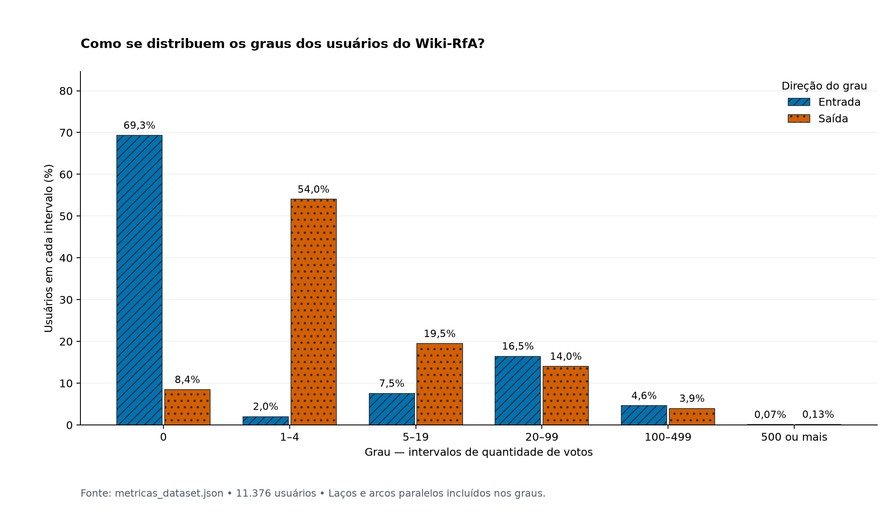
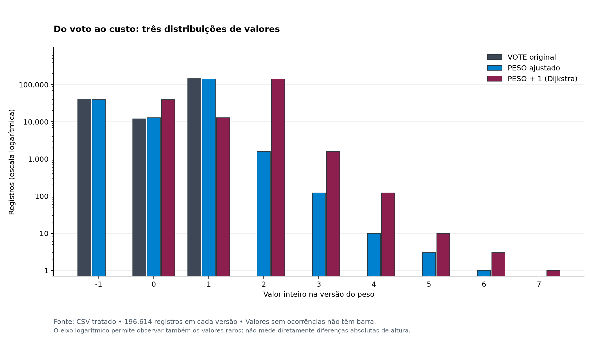
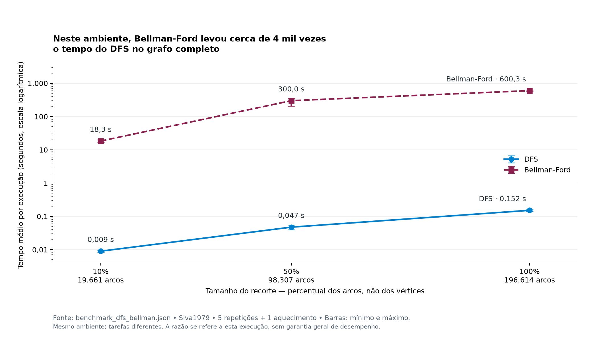
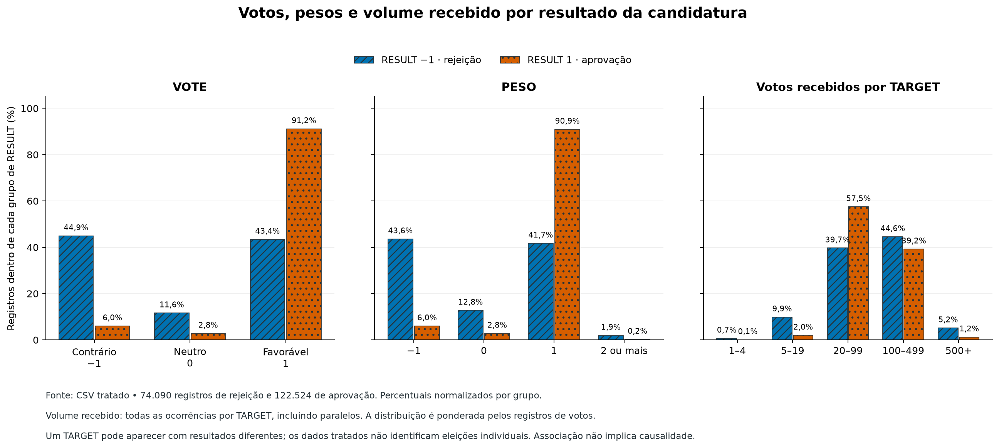
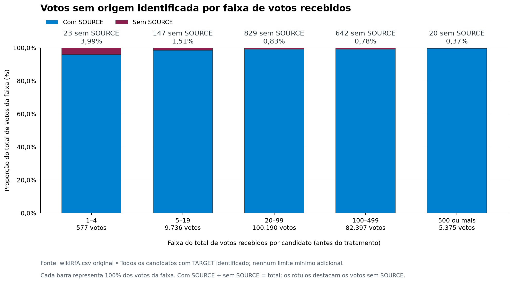
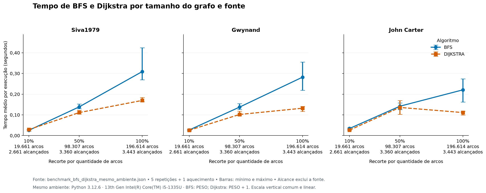
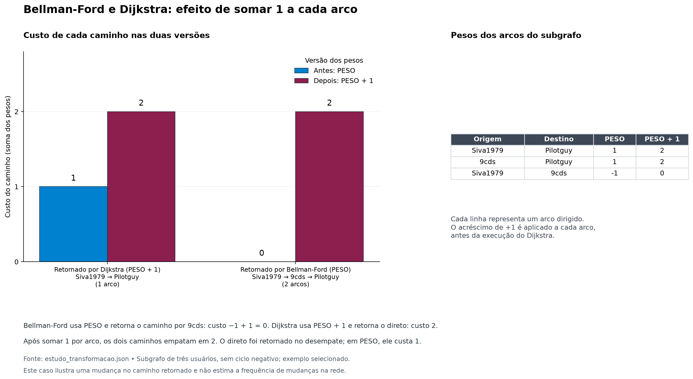

# Parte 2 — Wiki-RfA: dados, algoritmos e visualizações

Data de fechamento técnico: 24/11/2026.

Este documento reúne resultados existentes, decisões do grupo e textos aprovados na conversa. A compilação e as explicações técnicas tiveram apoio de ChatGPT (Codex). Não constitui uma declaração de autoria independente de IA. As notas atualizadas de B02 e A04 e o alcance das autorizações de IA precisam de revisão dos responsáveis antes da entrega acadêmica.

## 1. Dataset e pergunta de pesquisa

O Wiki-RfA representa votos nas candidaturas a administrador da Wikipédia. A versão reduzida utilizada foi obtida no Kaggle e tem quatro atributos originais: SOURCE, TARGET, VOTE e RESULT. 

Fonte usada: https://www.kaggle.com/datasets/boneacrabonjac/wiki-rfa

Referência da versão original: https://snap.stanford.edu/data/wiki-RfA.html

SOURCE e TARGET identificam o eleitor e o candidato. VOTE é -1, 0 ou 1, respectivamente contra, neutro ou a favor. RESULT é -1 ou 1, respectivamente rejeição ou aprovação. PESO é uma coluna derivada do tratamento. O grafo é dirigido: cada registro tratado liga eleitor a candidato. Os pesos negativos se originam dos votos contrários.

Pergunta de pesquisa aprovada: Como a transformação dos pesos negativos para permitir o uso de Dijkstra altera os caminhos mínimos e a interpretação dos custos no grafo Wiki-RfA?

## 2. Qualidade dos dados e tratamentos

O CSV bruto contém 198.275 registros. Há 1.661 sem SOURCE, distribuídos entre 926 candidatos. Não foram encontrados valores ausentes em TARGET, VOTE ou RESULT. A causa da ausência não foi determinada; não foi assumida ausência aleatória. Os registros sem origem identificada foram excluídos apenas da construção do grafo, pois atribuir um eleitor exigiria inventar informação. Permanecem preservados no CSV bruto. O grafo tratado representa 196.614 registros com eleitor identificado; a exclusão pode afetar graus e conectividade.

Laços e arcos paralelos foram mantidos. Não há data nem identificador de eleição nesta versão, de modo que linhas iguais não comprovam duplicação indevida. Repetições exatas são definidas simultaneamente por SOURCE, TARGET, VOTE e RESULT. Dentro de cada grupo, na ordem original, PESO = VOTE + número da ocorrência, começando em zero. VOTE é preservado. A regra foi informada e confirmada por André, com atribuição da sugestão à professora Laura, conforme o log.

Outliers foram conferidos em verificacao_outliers.json, sem novas exclusões. Com limites de 1,5 IQR nos graus, incluindo zeros, foram sinalizados 2.150 usuários na entrada e 1.718 na saída. Os cinco maiores de cada direção foram conferidos contra os registros brutos mantidos. As 14 ocorrências com PESO >= 4 foram rastreadas; o máximo é 6 e os valores conferem com a regra de incremento. Ser sinalizado por uma regra estatística não foi tratado como prova de erro.

A exploração de RESULT compara VOTE, PESO agrupado e volume recebido por TARGET entre grupos de resultado. São 74.090 registros no grupo -1 e 122.524 no grupo 1. Existem 236 TARGETs com resultados diferentes; sem identificador de eleição, não se deve reduzir cada candidato a um único resultado. As proporções são ponderadas pelos registros de votos, não por candidatos ou eleições.

## 3. Representação e métricas

O grafo é um dicionário de listas de pares (destino, peso). Origens e destinos são criados como chaves, incluindo candidatos que apenas recebem votos. Todas as ocorrências são preservadas, inclusive laços e paralelos.

| Métrica | Valor |
|---|---:|
| Vértices | 11.376 |
| Arcos, com laços e paralelos | 196.614 |
| Laços, por ocorrência | 103 |
| Pares dirigidos distintos, com laços | 188.077 |
| Pares distintos sem laço | 187.984 |
| Densidade dos pares sem laço | 0,00145271325 |
| Grau de entrada: mínimo / máximo / média | 0 / 978 / 17,2832 |
| Grau de saída: mínimo / máximo / média | 0 / 1.232 / 17,2832 |
| Votos originais negativos | 20,68% |
| Pesos ajustados negativos | 20,169% |

Cada arco paralelo contribui separadamente para os graus. Um laço soma um na entrada e um na saída. A soma dos graus de entrada e a soma dos de saída são iguais ao número de arcos. A densidade usa pares distintos sem laço divididos por V(V-1), para medir ocupação dos pares possíveis sem confundir multiplicidade com densidade de grafo simples. Distribuições e graus por usuário estão em metricas_dataset.json.

## 4. Algoritmos e casos obrigatórios

BFS foi executado em Siva1979, 'sed e !---slappdash---!. Calcula o menor número de arcos e ignora os pesos. Para Siva1979, alcançou 3.443 outros usuários e a maior distância finita foi de cinco arcos. Inalcançáveis são exportados como null. Brenda conferiu manualmente o recorte Siva1979 → Ceranthor → Salvio giuliano → 07bargem, com distâncias 0, 1, 2 e 3; o último arco tem PESO -1 e continua contando como um passo.

DFS foi executado nas mesmas três fontes. Registra descoberta, término, predecessores, classificação de arcos e ciclos dirigidos, preservando ocorrências paralelas. Seu indicador de ciclo não informa se um ciclo tem peso negativo. A conferência técnica exportada é automática; o arquivo conferencia_tecnica_dfs.json não deve ser apresentado como conferência manual de André.

Dijkstra foi executado para cinco pares distintos, com uma busca completa por origem. Como o menor PESO é -1, o grafo separado com PESO + 1 não contém pesos negativos. O algoritmo original recusa pesos negativos. O custo exportado nos cinco pares é o custo transformado. Os caminhos não podem ser apresentados como mínimos da versão anterior por simples equivalência de custos.

Bellman-Ford foi executado em dois subgrafos induzidos reais. Malleus Fatuorum → BDD tem peso -1 e não possui ciclo. Rcsprinter123 → Jasper Deng → Rcsprinter123 tem dois arcos de peso -1 e custo de ciclo -2. O ciclo é exibido com a sequência e as ocorrências de arcos. Distâncias provisórias do caso com ciclo negativo não são apresentadas como mínimos finitos.

Os quatro arquivos de casos, com seus metadados, foram incluídos em casos_obrigatorios no parte2_report.json. Nenhum dos exemplos pequenos é apresentado como amostra representativa da rede inteira.

## 5. Benchmark, escalabilidade e comparação técnica

Os recortes são prefixos de 10%, 50% e 100% das ocorrências embaralhadas uma vez com semente 42. São aninhados e preservam os pesos já calculados. Os vértices efetivos são a união das origens e destinos selecionados. Há 19.661, 98.307 e 196.614 arcos e 5.636, 9.187 e 11.376 vértices, respectivamente.

As fontes do benchmark são Siva1979, Gwynand e John Carter, escolhidas deterministicamente no menor recorte por grau de saída >= 3, ordem por grau decrescente e nome crescente, nas posições 0, n // 4 e n // 2. São mantidas nos três tamanhos.

Apenas a chamada do algoritmo é cronometrada com perf_counter. Há um aquecimento fora do cronômetro e cinco repetições por configuração. Preparação, exportação e conferência de alcance ficam fora. O tempo inclui a preparação interna de cada implementação. São preservados média, mínimo, mediana, desvio padrão amostral e os cinco tempos individuais. Barras das figuras representam mínimo e máximo, não intervalos de confiança.

A consolidação atual usa benchmark_bfs_dijkstra_mesmo_ambiente.json e benchmark_dfs_bellman.json. Ambos registram Python 3.12.6, Windows 10.0.26300 como versão do sistema, Intel Core i5-1335U e 16.847.937.536 bytes de memória. O hash do CSV coincide nas contribuições e com o arquivo atual. Metadados iguais não comprovam carga idêntica da máquina durante sessões distintas.

BFS, DFS e Dijkstra têm três fontes em cada tamanho. Bellman-Ford tem três fontes em 10% e 50% e Siva1979 em 100%. Isso totaliza 34 configurações e 170 tempos. O critério escrito exige os quatro algoritmos em três tamanhos e três fontes especificamente para BFS/DFS; não exige explicitamente três fontes de Bellman-Ford por tamanho. A redução em 100% limita a comparação entre fontes e é preservada no relatório. As duas fontes adicionais completariam o plano ampliado, mas não são tratadas aqui como requisito escrito ausente.

Para a fonte comum Siva1979, as médias registradas em segundos são:

| Algoritmo | 10% | 50% | 100% |
|---|---:|---:|---:|
| BFS | 0,025365 | 0,138694 | 0,309036 |
| DFS | 0,008978 | 0,047360 | 0,151690 |
| Dijkstra | 0,028914 | 0,111150 | 0,169753 |
| Bellman-Ford | 18,344376 | 300,042496 | 600,291621 |

Comparação técnica: BFS é adequado para alcance e mínimo de arcos; DFS para estrutura e ciclos dirigidos; Dijkstra para mínimos com pesos não negativos; Bellman-Ford para mínimos com pesos negativos e detecção de ciclos negativos alcançáveis. Não respondem à mesma pergunta, portanto menor tempo não torna um deles substituto geral dos demais.

BFS e DFS têm custo O(V+E) nesta representação, incluindo a preparação do BFS. Dijkstra usa heap com entradas repetidas e descarte das antigas; um limite conservador para o multigrafo é O(V + E log E). Bellman-Ford realiza todas as V-1 passagens e tem custo O(VE); não foi introduzida parada antecipada. Os resultados são compatíveis com tarefas e custos diferentes, mas três tamanhos e cinco repetições não demonstram uma lei assintótica nem isolam causas de cada diferença de tempo.

O BFS usa deque e dicionários, sem fila por pop(0) ou busca de visitados em lista. Percorre todos os arcos também na preparação; Dijkstra percorre os arcos na validação dos pesos. Não foi identificado erro que justificasse alterar os algoritmos apenas para mudar sua posição no gráfico. Os conjuntos alcançados por BFS e Dijkstra foram comparados independentemente e coincidem nas nove combinações de fonte e tamanho.

## 6. Transformação e resposta à pergunta de pesquisa

Para um caminho com k arcos, somar 1 a cada arco acrescenta k ao custo total. Caminhos com comprimentos diferentes recebem acréscimos diferentes. O incremento por repetição que produz PESO e o deslocamento para Dijkstra são decisões distintas: o primeiro altera VOTE conforme a regra do grupo; o segundo altera PESO para permitir executar Dijkstra.

Texto aprovado por Brenda: No exemplo analisado, somar 1 a cada arco altera a preferência entre os caminhos: o caminho via 9cds, inicialmente mais barato, passa a empatar com o direto. O Dijkstra retorna um caminho ótimo nos pesos transformados, mas esse caminho tem custo maior em PESO do que o encontrado por Bellman-Ford. Portanto, a transformação permite executar Dijkstra, porém não garante preservar os caminhos mínimos anteriores. Como analisamos um único par em um subgrafo, não podemos afirmar com que frequência isso acontece na rede inteira.

O estudo preserva os três arcos reais entre Siva1979, 9cds e Pilotguy. O direto tem um arco e passa de custo 1 para 2. Via 9cds são dois arcos, de pesos -1 e 1, passando de custo 0 para 2. O caminho direto foi retornado em situação de empate; ambos são mínimos nos pesos transformados. Não houve inversão estrita em favor do direto. Percursos na rede de votos são uma modelagem matemática e não comprovam, por si sós, relações causais entre usuários ou equivalência entre soma dos pesos e resultado eleitoral.

## 7. Visualizações

O conjunto contém sete imagens: quatro exploratórias de dados (A01, A02, A04 e B01), duas explanatórias (A03 e B03) e uma análise visual de desempenho (B02). B02 não é usada para cumprir a contagem das exploratórias de dados. As escolhas e os textos completos estão nos documentos de visualizações de Brenda e André. A revisão autoral dos textos compilados com IA continua necessária.

### A01 — Distribuição dos graus

Fonte: metricas_dataset.json. Nota registrada no documento de André: dos 11.376 usuários, 7.885 (69,3%) têm grau de entrada zero e 961 (8,4%) têm grau de saída zero. A faixa de um a quatro votos emitidos reúne 6.144 usuários (54,0%). Barras agrupadas distinguem os dois papéis em faixas comuns. Os graus são do grafo tratado; a agregação não determina a causa dos extremos nem os transforma em erros.

### A02 — Distribuição dos votos e pesos

Fonte: CSV tratado, 196.614 registros em cada versão. O documento de André registra 2.834 linhas cujo PESO difere de VOTE e redução de 40.667 para 39.655 registros negativos. A escala logarítmica permite apresentar frequências muito diferentes; altura não representa diferença absoluta linear. Eliminar negativos não comprova preservação de caminhos. Esse achado motivou a investigação do estudo B03, conforme confirmação de Brenda.

### A03 — Tempos de DFS e Bellman-Ford

Fonte: benchmark_dfs_bellman.json; Siva1979 nos três tamanhos. O documento de André registra razão de aproximadamente 3.957 entre as médias de Bellman-Ford e DFS em 100%, específica deste ambiente e destas tarefas. A exploração da tabela de tempos motivou a mensagem e o título quantitativo. A escala logarítmica acomoda as ordens de grandeza; barras indicam mínimo e máximo. DFS e Bellman-Ford não são substitutos equivalentes.

### A04 — Relações com RESULT

Fonte: CSV tratado e dados_visualizacoes_andre.json. Os painéis relacionam VOTE, PESO e volume recebido com RESULT. No grupo de rejeição, 32.184 de 74.090 votos são favoráveis (43,44%); no de aprovação, 111.695 de 122.524 (91,16%). Os percentuais são normalizados por grupo e não representam proporção de candidatos aprovados. A mesma pessoa pode aparecer em registros com resultados diferentes. Esta descrição factual foi compilada com IA para revisão de André, não é uma interpretação autoral já aprovada.

### B01 — Votos sem origem por faixa

Fonte: CSV bruto. Nota aprovada por Brenda: A primeira faixa apresenta o maior percentual de votos sem origem identificada, mas reúne apenas 577 votos, dos quais 23 estão sem SOURCE. Por isso, o percentual deve ser lido junto às quantidades absolutas: a barra mais alta não representa a maior quantidade de registros sem origem.

Brenda aprovou as faixas 1-4, 5-19, 20-99, 100-499 e 500 ou mais como escolha de apresentação para cinco grupos legíveis, mantendo poucos votos. Os cortes não são limites estatísticos. A medida é a proporção agregada por faixa, não a média de percentuais individuais. As quantidades sem SOURCE são 23, 147, 829, 642 e 20, totalizando 1.661.

### B02 — Análise visual de desempenho

Fonte atual: benchmark_bfs_dijkstra_mesmo_ambiente.json. Brenda escolheu três painéis para comparar os algoritmos por fonte e recorte, com escala vertical comum. Círculos e linha contínua identificam BFS; quadrados e linha tracejada identificam Dijkstra, além das cores.

Nota atualizada com IA para revisão de Brenda: Para Siva1979, BFS e Dijkstra apresentam tempos médios próximos no recorte de 10%. Nos recortes de 50% e 100%, a média do BFS fica acima da do Dijkstra. Para Gwynand e John Carter, o BFS apresenta média maior nos três tamanhos. Há sobreposição entre alguns intervalos mínimo-máximo; em 100%, o BFS apresenta maior amplitude entre as repetições nas três fontes. Esses resultados descrevem as implementações e o ambiente medidos, sem demonstrar uma vantagem geral de Dijkstra. Os conjuntos de usuários alcançados foram iguais entre os algoritmos em cada configuração.

### B03 — Efeito da transformação

Nota aprovada por Brenda: Neste exemplo, a transformação elimina a vantagem do caminho via 9cds, que tinha menor custo em PESO. Como esse caminho possui dois arcos, seu custo aumenta em 2, enquanto o direto aumenta em 1. Os caminhos passam a empatar, e o Dijkstra retorna o direto, cujo custo nos pesos anteriores à transformação é maior. Isso ilustra que somar uma constante a cada arco pode alterar o caminho retornado, sem preservar a preferência pelo caminho originalmente mais barato.

Ligação aprovada entre exploração e explicação: Ao observar a distribuição de PESO e PESO + 1, surgiu a dúvida sobre se eliminar os pesos negativos também alteraria os caminhos mínimos. Para investigar essa questão, comparei os custos de dois caminhos antes e depois da transformação no subgrafo selecionado. A figura explanatória apresenta esse exemplo e mostra como caminhos com quantidades diferentes de arcos recebem acréscimos diferentes, chegando ao empate observado.

Barras agrupadas foram escolhidas por Brenda para comparar poucos caminhos e duas versões de custos. Listras e pontos distinguem as versões além de azul e laranja-avermelhado. O zero é escrito. O empate é explícito, e o exemplo não estima a frequência de mudanças na rede.

## 8. Reprodução e verificações

O CSV tratado deve ter SHA-256 de16066d90875782f2daffae3adbe5c513f0fa9743ad242d3e1fcbf5c635e7c2. O download e o tratamento estão em data/dataset_parte2/baixar_wikiRfA.ipynb. Os CSVs não são versionados; os notebooks e a fonte do download são disponibilizados. O notebook de experimentos usa os JSONs salvos nas seções 16 e 17 para conferir e consolidar, sem medir algoritmos novamente.

Para reproduzir os casos: python -m src.cli --dataset data/dataset_parte2/processed/wikiRfA_tratado.csv --experimentos --out out/parte2

Para reproduzir as sete figuras: python -m src.viz --parte2

Para verificar testes: python -m pytest -q

Foram executados 81 testes em clone limpo do commit 85ede8a e os mesmos 81 em cópia com as alterações locais, sem instalar dependências. O CSV e os benchmarks de origem foram preservados nas verificações. As validações da consolidação rejeitaram arquivos incompletos, hashes divergentes, duplicações e estatísticas inconsistentes. A cobertura futura de três fontes de Bellman-Ford foi testada apenas com dados simulados em memória, não exportados como medições reais.

## 9. Contribuições e revisão da entrega

Responsabilidades informadas pelo grupo: Brenda - BFS, Dijkstra, transformação, consolidação, figuras B01-B03 e suas seções do relatório. André - tratamento/carregamento/métricas conforme a divisão revisada, DFS, Bellman-Ford, benchmark na máquina comum, figuras A01-A04, análise de RESULT e outliers. A contribuição de IA em código, figuras e redação está registrada no log e no rascunho da declaração. Esta descrição de responsabilidades deve ser conciliada com os commits e com a matriz completa dos demais integrantes no relatório conjunto.

O material técnico da Parte 2 está reunido neste documento e no PDF correspondente. O PDF é uma compilação com apoio de IA para revisão, não substitui o relatório conjunto da Parte 1 nem a validação de autoria pelas professoras. Permanecem atos do grupo: revisar as notas atualizadas e a discussão compilada, confirmar nomes/matrículas e contribuições dos demais integrantes, escrever a reflexão de IA, assinar a declaração e entregar o material. Não foram fabricadas assinaturas, autorizações, reflexões pessoais ou medições ausentes.
